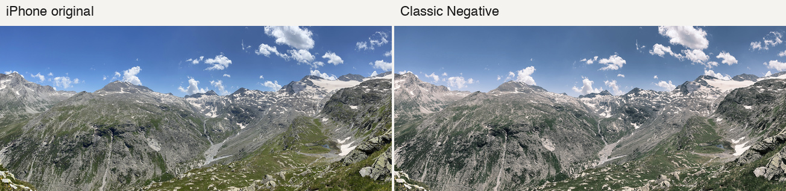

# Digital to Film

A browser-based iPhone photo converter by David Driscoll. Choose a film-inspired recipe, compare it with the original, and export a full-resolution JPEG. Foreground subjects receive one pass of the chosen recipe and the background receives two. Subject detection and conversion run on your device.

**[Try the live demo →](https://ddrisco11.github.io/digitaltofilm_conversionmodel/)** · [How the converter was trained](converter/README.md) · [Dataset and photo credits](DATASET.md)

[](https://ddrisco11.github.io/digitaltofilm_conversionmodel/)

*Saas-Almagell – mountains 2*, photographed by Tiia Monto on iPhone 13. Resized for display and color graded on the right. [Original photograph](https://commons.wikimedia.org/wiki/File:Saas-Almagell_-_mountains_2.jpg) · [CC BY 4.0](https://creativecommons.org/licenses/by/4.0/)

## From training pairs to a browser demo

I built this project to see how much of a film recipe a small color transform could reproduce. I started with a fixed color lookup table, then trained a second model that adjusts its table to the brightness, contrast and red–blue balance of each photograph. The browser measures those properties on a 64 × 64 preview and applies the resulting table to the full-resolution image in a worker.

**Classic Negative** learns from 160 matched FilmSet input/recipe pairs. **Gold-inspired** adds a color correction estimated from 256 digital photographs and 256 unpaired film references in DigitalFilm. The second recipe is experimental. Scene content, lighting and film scanning can all influence those color statistics. [FilmSet](https://www.kaggle.com/datasets/xuhangc/filmset) · [DigitalFilm](https://huggingface.co/datasets/Richards-Sheehy-sudo/DigitalFilm_dataset)

## Results

In the original single-pass color benchmark on 48 held-out FilmSet pairs, the scene-aware model improved mean per-image PSNR by 0.25 dB over the fixed table. Higher values indicate closer agreement with the published Classic Negative recipe.

| Method | PSNR |
| --- | ---: |
| Original digital image | 25.98 dB |
| Fixed table | 37.49 dB |
| Scene-aware table | **37.73 dB** |

I also assembled a separate index of 39 real film/digital comparisons across 36 recorded scene groups. A blind review tool shows the film reference alongside randomized conversions. Human preference and stock fidelity remain open evaluation questions. [Pair index](pairs.csv) · [Measurements and training manifest](converter/README.md#training-and-test-results)

## Run it yourself

The static demo includes the model, a browser renderer and a HEIC decoder loaded on demand. From the repository root, run:

```sh
python3 -m http.server 8000 --directory docs --bind 127.0.0.1
```

Open [the local demo](http://127.0.0.1:8000). For batch processing, model retraining or offline evaluation, use the [Python converter instructions](converter/README.md). Run `python3 converter/export_web.py` after retraining to regenerate the browser weights.

## Sources and reuse

The manifests document source files, creators and available license information. Upstream datasets, research figures and the demo photograph have their own terms. Restricted photographs are represented by source links in the public repository. [Dataset provenance](DATASET.md) · [Training sources](converter/README.md) · [HEIC decoder credits](docs/vendor/README.md)
