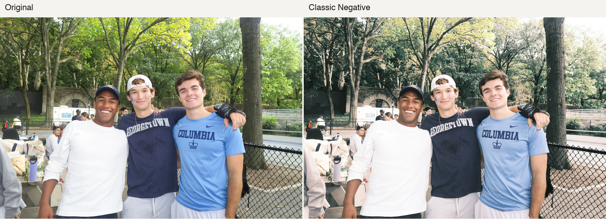
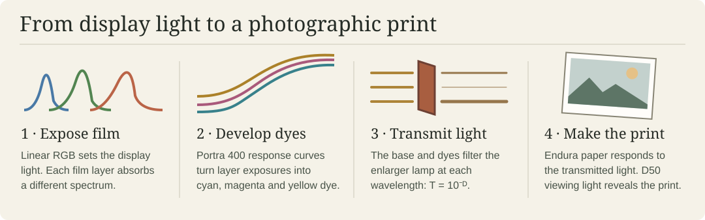
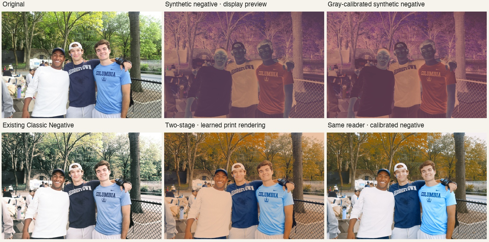
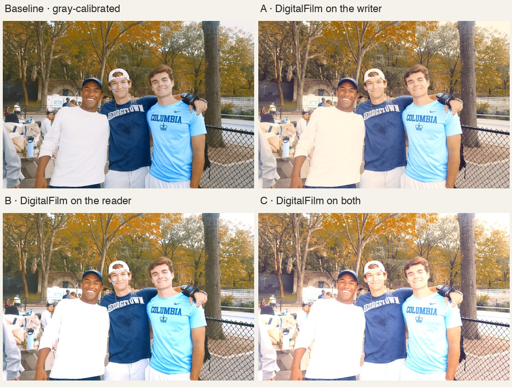

# Digital to Film

A browser-based iPhone photo converter. Choose a film-inspired recipe, compare it with the original, and export a full-resolution JPEG. Foreground subjects receive one pass of the chosen recipe and the background receives two. Subject detection and conversion run on your device.

**[Choose a live experiment →](https://ddrisco11.github.io/digitaltofilm_conversionmodel/)** · [How I trained the converter](converter/README.md) · [Dataset and photo credits](DATASET.md)

[](https://ddrisco11.github.io/digitaltofilm_conversionmodel/)

The right panel shows Classic Negative with one pass on the foreground and two on the background.

## Spectral darkroom

I built a four-stage, deterministic simulation of photographing an image on a display. I choose one film exposure and enlarger balance for the entire photo. [Open the spectral darkroom →](https://ddrisco11.github.io/digitaltofilm_conversionmodel/physics.html)



I integrate display emission against film sensitivity over **59 wavelengths (405–695 nm)**. The negative’s base and dyes determine how much light reaches the paper at each wavelength. A 3200 K enlarger exposes the paper, and a D50 viewing light determines its rendered color. The demo lets you inspect and export the layer exposure, dye map, light-box negative, or final print. The first two views use illustrative scales.

The browser interpolates compact lookup tables precomputed from the spectral model. The Python implementation saves a full-resolution dye negative that the printer can read independently. The reference passed a 256-step gray ramp with zero luminance reversals. The park foliage still shifts toward olive; accuracy to a real print would require a matched physical exposure and print. [Implementation and credits](experiments/physics/README.md)

## Experimental synthetic negative lab

From the [experiment chooser](https://ddrisco11.github.io/digitaltofilm_conversionmodel/), open the [Synthetic negative lab](https://ddrisco11.github.io/digitaltofilm_conversionmodel/negative.html). I built this mode to test whether a digital photo can pass through a film-like intermediate before a separate model renders the print. **Inspect negative** shows the intermediate in display colors. **Gray calibration** balances the negative writer against a virtual gray ramp. The download exports the current view as a JPEG. The Python experiment can also save the actual 16-bit negative.

I approximated Fuji NPH400’s published density curves to generate the negative. The print reader sees only its 16-bit transmission values. I trained it on seven aligned negative/print pairs from three BlueNeg rolls. On two frames from a fourth roll, average absolute RGB error fell from 47.2 levels for a simple density stretch to 20.2 for the learned reader (0–255 scale). That measures the reader on real negatives. I still need matched digital, negative, and print captures to test end-to-end film fidelity. On the demo portrait, gray calibration brings the white shirt closer to neutral, while the foliage still shifts toward amber.



### Where does DigitalFilm calibration help?

In the lab, I can switch the **DigitalFilm calibration** selector between the baseline, **A** (negative writer only), **B** (print reader only), and **C** (both). All three use the same gray-calibrated starting point and the reader receives only the negative. I fitted the two adjustments independently on the same 256 digital photos and 256 unpaired Gold 200 references. C applies both at their fitted strengths.



On a separate 64 digital and 64 film image holdout, the mean gap between output and reference RGB quantiles was **24.21** for the baseline, **8.14** for A, **13.38** for B and **33.07** for C (0–255 scale, lower is closer). A best matched this color statistic; C stacked the corrections and washed out highlights on the park portrait. Images are unpaired, so the metric measures agreement between groups of images. It cannot establish stock fidelity or which result looks best.

BlueNeg image credit: **Copyrighted by Tien-Tsin Wong**. [Experiment, code and sources](experiments/negative/README.md) · [BlueNeg dataset](https://huggingface.co/datasets/ttgroup/blueneg-release) · [Per-frame scores](experiments/negative/scores.json)

## From training pairs to a browser demo

I wanted to see how much of a film recipe a small color transform could reproduce. I started with a fixed color lookup table, then trained a second model that adjusts its table to the brightness, contrast and red–blue balance of each photograph. The browser measures those properties on a 64 × 64 preview and applies the resulting table to the full-resolution image in a worker.

**Classic Negative** learns from 160 matched FilmSet input/recipe pairs. **Gold-inspired** adds a color correction estimated from 256 digital photographs and 256 unpaired film references in DigitalFilm. The second recipe is experimental. Scene content, lighting and film scanning can all influence those color statistics. [FilmSet](https://www.kaggle.com/datasets/xuhangc/filmset) · [DigitalFilm](https://huggingface.co/datasets/Richards-Sheehy-sudo/DigitalFilm_dataset)

## Results

In the original single-pass color benchmark on 48 held-out FilmSet pairs, the scene-aware model improved mean per-image PSNR by 0.25 dB over the fixed table. Higher values indicate closer agreement with the published Classic Negative recipe.

| Method | PSNR |
| --- | ---: |
| Original digital image | 25.98 dB |
| Fixed table | 37.49 dB |
| Scene-aware table | **37.73 dB** |

I also assembled a separate index of 39 real film/digital comparisons across 36 recorded scene groups. A blind review tool shows the film reference alongside randomized conversions. Human preference and stock fidelity remain open evaluation questions. [Pair index](pairs.csv) · [Measurements and training manifest](converter/README.md#training-and-test-results)

## Run it yourself

The static demo includes the model, a browser renderer and a HEIC decoder loaded on demand. From the repository root, run:

```sh
python3 -m http.server 8000 --directory docs --bind 127.0.0.1
```

Open [the local demo](http://127.0.0.1:8000). For batch processing, model retraining or offline evaluation, use the [Python converter instructions](converter/README.md). Run `python3 converter/export_web.py` after retraining to regenerate the browser weights.

## Sources and reuse

The manifests document source files, creators and available license information. Upstream datasets, research figures and the demo photograph have their own terms. Restricted photographs are represented by source links in the public repository. [Dataset provenance](DATASET.md) · [Training sources](converter/README.md) · [HEIC decoder credits](docs/vendor/README.md)
