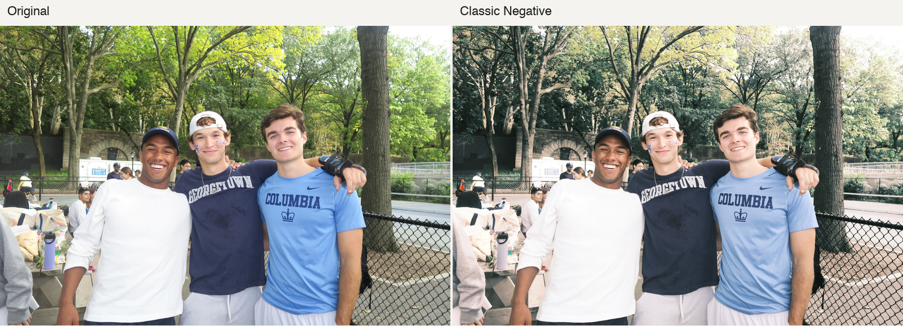

# iPhone film converter pilot

The converter exports full-resolution SDR sRGB photographs. The default preset learns FilmSet’s Classic Negative rendering. A second experimental preset adjusts its tones using unpaired digital photographs and film references from the Gold 200 collection in DigitalFilm.



I used this park portrait to compare the original (left) with my Classic Negative preset (right).

## Convert an image

Run these commands from the repository root with Python 3.12 or newer. HEIC decoding uses the macOS command-line image tool. JPEG and PNG decoding use Pillow.

```sh
python3 -m venv .venv
.venv/bin/python -m pip install -r converter/requirements.txt
.venv/bin/python converter/render.py input.HEIC classic-negative.jpg
.venv/bin/python converter/render.py input.HEIC gold-experimental.jpg --gold
.venv/bin/python converter/render.py input.HEIC fixed-baseline.jpg --variant fixed
```

The Python converter, browser demo and review builder detect foreground on the original image using the compact U²-Net model. Each full recipe runs once on the original and again on the first result. A soft mask blends the two results so the subject receives one pass and the background receives two. Difficult edges and low-contrast subjects can receive a partial second pass. When the mask is empty, the whole scene receives two passes. Training and recipe benchmarks use the single-pass color transform. [Foreground model and runtime credits](../docs/vendor/foreground/README.md)

The pipeline honors EXIF orientation and embedded ICC profiles, treats untagged RGB as sRGB, and saves a tagged SDR image. Export strips source metadata. This pilot handles color and tone. Grain, halation and HDR output are outside its scope.

## Training and test results

Both Classic Negative models use paired sRGB input and target samples. The fixed model fits a smooth color transform to 1,024 corresponding pixels per training image. The adaptive model also uses image brightness, contrast and red–blue balance to adjust that transform. Both use ridge regression and are exported as 33³ lookup tables for full-size rendering. I trained both models on my M2 MacBook Air using NumPy and set aside the digital-to-film collection for visual review.

| Model | Mean per-image PSNR on 48 FilmSet test images |
| --- | ---: |
| Unmodified digital input | 25.977 dB |
| Fixed Classic Negative LUT | 37.485 dB |
| Adaptive Classic Negative LUT | 37.733 dB |

These single-pass scores measure agreement with the paired software recipe in 8-bit sRGB. The adaptive model gained 0.25 dB over the fixed model on this subset. Real-film resemblance and user preference require separate review.

**FilmSet.** I trained on 160 pairs from the official training split. I selected 48 pairs from the official test split by filename hash and excluded those filenames from training. The manifest records every archive member. Zinuo Li, Xuhang Chen, Shuqiang Wang and Chi-Man Pun created FilmSet. [Dataset version 1](https://www.kaggle.com/datasets/xuhangc/filmset/versions/1) · [Paper](https://www.ijcai.org/proceedings/2023/129) · [Pilot manifest](filmset-classneg.csv) · [Scores](filmset-classneg.json)

**DigitalFilm.** The Gold experiment uses 256 unpaired digital photos and 256 film references sampled independently from the Gold 200 archive. It estimates per-channel tonal adjustments from brightness-stratified groups, then applies 40% of the estimated shift after the adaptive LUT. The color of the scenes and the scan processing can influence this estimate. The Gold preset has no paired stock-fidelity score. Source attribution is limited to the dataset and archive paths where the publisher gives no individual image credit. The manifest records the members and archive checksum. Source photographs are excluded from this repository. [DigitalFilm dataset card and credits](https://huggingface.co/datasets/Richards-Sheehy-sudo/DigitalFilm_dataset) · [Gold calibration and member manifest](digitalfilm-gold.json)

## Reproduce the models and blind review

Download FilmSet v1 and unpack it. Download the Gold ZIP from the DigitalFilm dataset card. Run the commands below from the repository root. The fitter expects the FilmSet directory containing the official train and test subdirectories.

```sh
.venv/bin/python converter/train.py /path/to/FilmSet
.venv/bin/python converter/fit_gold.py /path/to/Kodak_gold_200.zip
.venv/bin/python converter/review.py /path/to/blind-film-comparison.html
```

The review builder requires the complete local collection, including the local-only photos. It selects the first entry for each recorded scene group and shuffles the three methods within each row. It produces an offline comparison with source credits and a revealable key. Each viewer can record a choice before revealing the methods. The repository tracks the code, model files, measurements, manifests and demo photograph.
